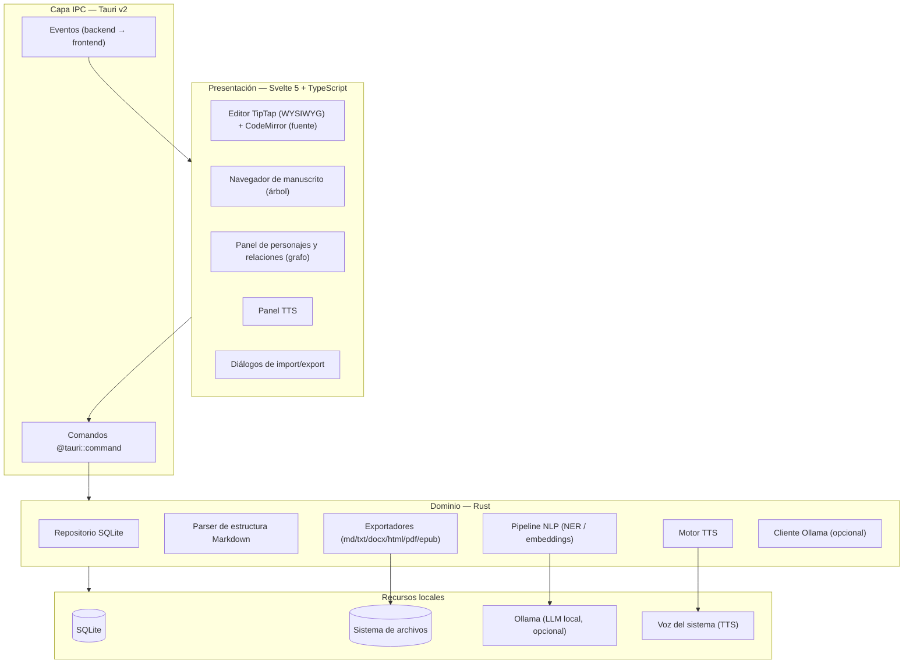
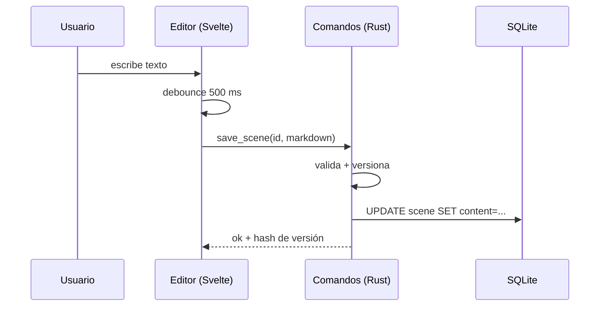
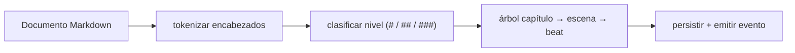
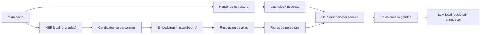

# 02 — Arquitectura

Diseño de arquitectura por capas para **Pluma**. El principio rector es **separar la UI
(Svelte) del dominio (Rust)** a través del IPC de Tauri, manteniendo toda la lógica de
negocio, persistencia y NLP en el backend para que sea testeable y portable.

---

## 1. Diagrama de componentes



---

## 2. Responsabilidades por capa

### 2.1 Frontend (Svelte 5)

- **Estado de UI** y *stores* reactivas (proyecto actual, capítulo abierto, selección).
- **Editor**: TipTap como editor principal (bloques, arrastrar, comandos), con un toggle a
  modo fuente en CodeMirror. La sincronización de estado se hace **debounced** hacia Rust.
- **Paneles**: navegador de manuscrito, fichas de personaje, grafo de relaciones, TTS.
- **Sin lógica de negocio crítica**: solo orquestación y presentación.

> El frontend **no** escribe directamente en disco ni en SQLite; siempre llama comandos de
> Tauri. Esto centraliza la consistencia y el control de errores.

### 2.2 IPC (Tauri v2)

- Comandos `#[tauri::command]` expuestos al frontend (CRUD, parseo, NLP, export, TTS).
- Eventos `emit` para progreso largo y para el estado del TTS.
- Plugins: `fs`, `dialog`, `shell`, `opener`.

### 2.3 Dominio (Rust)

| Módulo | Responsabilidad |
|--------|-----------------|
| `db` | Conexión SQLite, migraciones, repositorios por entidad |
| `parser` | Convertir Markdown → árbol de capítulos/escenas (y viceversa) |
| `nlp` | NER, embeddings, resolución de alias, extracción de relaciones |
| `export` | Trait `Exporter` con implementaciones por formato |
| `tts` | Trait `TtsEngine` (nativo ahora, Piper después) |
| `llm` | Cliente HTTP a Ollama (opcional), con *prompt templates* |

---

## 3. Flujo de datos principal

### 3.1 Escritura y guardado



### 3.2 Análisis de estructura



---

## 4. Pipeline NLP (visión general)



> El detalle de cada etapa y las librerías recomendadas está en
> [`03-ia-local.md`](03-ia-local.md).

---

## 5. Estrategia de persistencia

- **SQLite** como única fuente de verdad.
- Migraciones versionadas con `PRAGMA user_version` (forward-only).
- Los archivos exportados (`.md`, `.docx`, …) son **derivados**, no la fuente de verdad.
- El contenido Markdown **crudo** se guarda por escena; el árbol de capítulos es una
  **proyección** reconstruible desde el Markdown (nunca hay divergencia).

---

## 6. Modelo de módulos en Rust (esqueleto de traits)

```rust
// export/mod.rs — patrón estrategia
#[async_trait]
trait Exporter {
    fn name(&self) -> &'static str;
    fn export(&self, project: &Project, options: &ExportOptions) -> Result<Vec<u8>>;
}

// tts/mod.rs — intercambiable nativo/neural
trait TtsEngine: Send + Sync {
    fn speak(&self, text: &str, voice: &str, rate: f32);
    fn stop(&self);
}

// nlp/mod.rs — pipeline desacoplado
struct NlpPipeline {
    ner: Box<dyn NamedEntityRecognizer>,
    embedder: Box<dyn Embedder>,
}
```

---

## 7. Seguridad y privacidad

- **Zero cloud**: ningún dato sale del equipo. El LLM opcional (Ollama) corre en
  `localhost` y es opt-in.
- El frontend solo tiene acceso a comandos permitidos (no acceso arbitrario al FS).
- Permisos de Tauri configurados con *capabilities* mínimas (allowlist de plugins).
