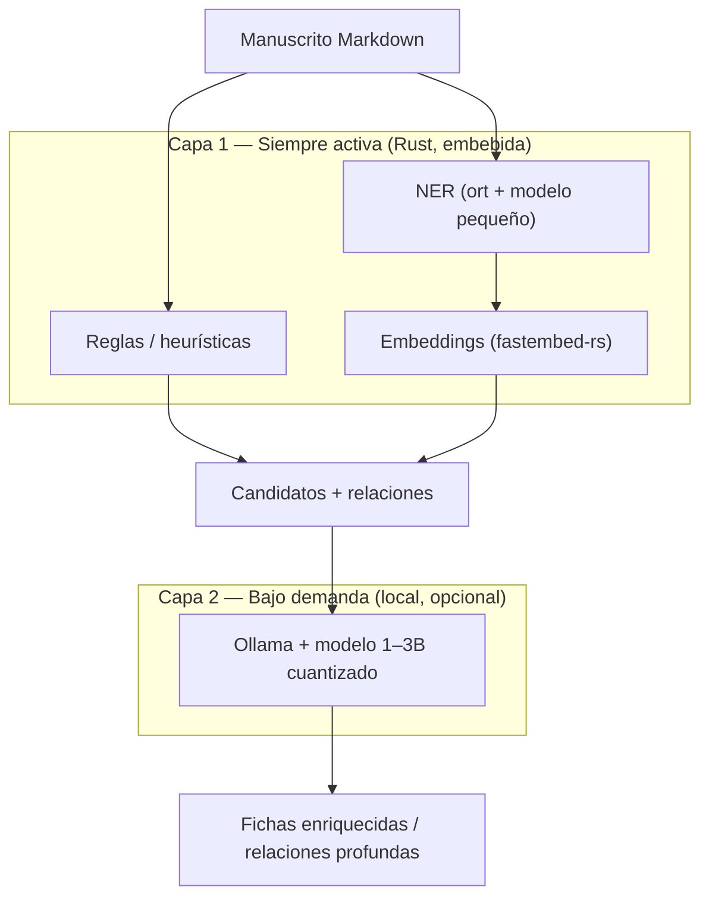

# 03 — IA local y ligera

Estrategia para detectar **personajes**, **relaciones** y **estructura narrativa** de
forma **100 % local** y **ligera** (CPU, sin GPU, modelos pequeños). Se propone un
enfoque **en capas**: reglas + embeddings + NER siempre activos, y un LLM local opcional
para enriquecimiento profundo.

---

## 1. Principios

1. **Offline-first**: nada se envía a servicios externos.
2. **Progresivo**: lo básico funciona sin LLM; el LLM es un extra opcional.
3. **Ligero**: modelos ≤ ~200 MB, inferencia en CPU con latencia aceptable.
4. **Determinista + asistido**: la IA **sugiere**, el autor **confirma/edita**.

---

## 2. Arquitectura de IA en capas



---

## 3. Tareas de NLP y solución recomendada

### 3.1 Estructura (capítulos / escenas / beats)

- **No requiere ML.** Se resuelve con un parser de encabezados Markdown (`pulldown-cmark`)
  y patrones configurables:
  - `# Título` → capítulo
  - `## Título` → escena
  - `### Título` → beat
- Regex para títulos numéricos/romanos: `Capítulo\s+\d+`, `Chapter\s+I+`, etc.
- **Recomendación**: implementación propia en Rust (`parser/`). Rápido y determinista.

### 3.2 Detección de personajes (NER)

| Opción | Estado | Librería | Modelo | Tamaño | Notas |
|--------|--------|----------|--------|--------|-------|
| **A (reglas)** | ✅ implementada | Heurísticas propias | — | 0 | Nombres en mayúscula, `— dijo Ana —`, apodos |
| **B (GLiNER2)** | ✅ implementada (opt-in) | `gliner2-rs` (span, ONNX) | `gliner2-multi-v1` | ~1 GB | NER zero-shot multilingüe, etiqueta `person` |

> Alternativa considerada: `rust-bert` (con `tch`/libtorch). Se **descarta** por ser
> pesado y de mantenimiento irregular. GLiNER2 sobre ONNX Runtime es más ligero y preciso.

**Recomendación**: usar **A** siempre (fallback) y activar **B** cuando se desee mayor
precisión con nombres ambiguos o no hispanos. Ambos orígenes se fusionan en el mismo
pipeline antes de agrupar alias.

### 3.3 Resolución de alias y agrupación

- **Embeddings** con `fastembed-rs` (crate `fastembed`), modelo
  `intfloat/multilingual-e5-small` (~118 MB) o `all-MiniLM-L6-v2` (~22 MB, solo inglés).
- Pipeline: embedding de cada mención contextual → similitud coseno + Levenshtein →
  agrupación → personaje canónico.
- **Recomendación**: `multilingual-e5-small` por su soporte de español.

### 3.4 Extracción de relaciones

**Sin LLM (Capa 1):**
- **Co-ocurrencia**: dos personajes en la misma escena → relación candidata.
- **Señales lingüísticas**: verbos de vínculo ("amaba", "odiaba", "era su hermano"),
  diálogo dirigido, proximidad.
- **Sentimiento** aproximado por léxico (polaridad en español) → positivo/negativo/neutro.

**Con LLM (Capa 2, opcional):** dado un fragmento con dos personajes, pedir
`{ tipo, intensidad, descripción }` en JSON.

### 3.5 Fichas de personaje automáticas

- **Sin LLM**: ensamblar ficha con atributos por patrones ("era alto", "ojos verdes"),
  rol por frecuencia de aparición y POV.
- **Con LLM**: resumir descripción, extraer rasgos/objetivos/arco de fragmentos.

---

## 4. Recomendación de LLM local (Capa 2)

Se recomienda **Ollama** como runtime y un modelo pequeño cuantizado:

| Modelo | Tamaño (Q4) | Calidad español | Notas |
|--------|-------------|-----------------|-------|
| **`qwen2.5:1.5b-instruct-q4_K_M`** ⭐ | ~1.0 GB | Muy buena | Mejor relación calidad/tamaño para español |
| `llama3.2:1b` | ~0.8 GB | Buena | Muy ligero |
| `phi3.5:mini` | ~2.2 GB | Buena | Mejor razonamiento, más pesado |
| `gemma2:2b` | ~1.6 GB | Buena | Alternativa sólida |

- **Por qué Ollama**: instalación trivial, API HTTP en `localhost:11434`, multi-OS. La app
  se comunica con `reqwest` desde Rust.
- **Alternativa embebida**: `mistral-rs` o `llama.cpp` para empaquetar el modelo dentro
  del binario. Más integración; recomendado solo en fase avanzada.

### Formato de salida (JSON) para el LLM

```json
{
  "character": { "name": "Ana", "role": "protagonista", "traits": ["obstinada"], "arc": "..." },
  "relationships": [
    { "with": "Pedro", "type": "mentor", "intensity": 0.8, "description": "..." }
  ]
}
```

> Se usa *JSON mode* de Ollama para garantizar salida válida.

---

## 5. Dependencias Rust (en uso)

```toml
# nlp — embeddings y NER
fastembed = "6.1"            # embeddings locales (ONNX), multilingual-e5-small
gliner2-rs = { version = "0.9", default-features = false, features = ["hub"] }  # NER GLiNER2

# runtime ONNX Runtime (bootstrap autocontenido)
ureq = "2"                   # descarga del runtime y del modelo
tar = "0.4"                  # extracción del runtime
flate2 = "1"                  # descompresión gzip (.tgz)
sha2 = "0.10"                # verificación de integridad

# utilidades
pulldown-cmark = "0.13"      # parseo Markdown
strsim = "0.11"              # similitud de cadenas (Levenshtein/Jaro)
```

> El runtime de ONNX Runtime se descarga una sola vez (con permiso) desde los
> **releases oficiales** (`src/runtime.rs`) y se fija vía `ORT_DYLIB_PATH`, porque
> `ort` se compila en modo `load-dynamic` al convivir `fastembed` y `gliner2-rs`
> en el mismo árbol. Se usa el release oficial (no el CDN de `ort-sys`) porque este
> último solo publica la librería estática para macOS.

---

## 6. Presupuesto de recursos

| Componente | RAM (aprox.) | Disco | GPU |
|-----------|--------------|-------|-----|
| Embeddings `multilingual-e5-small` | ~300 MB | ~118 MB | No |
| NER GLiNER2 (`gliner2-multi-v1`) | ~1 GB | ~1 GB | No |
| LLM `qwen2.5:1.5b` (Ollama) | ~1.5–2 GB | ~1.0 GB | No (CPU ok) |

> Total con todo local: ~3 GB RAM en picos de análisis. Sin LLM (GLiNER2 + embeddings): ~1.3–1.5 GB.
> Los modelos se cargan/liberan por uso salvo perfil `keep_loaded`: el pico es transitorio.

---

## 7. Riesgos y mitigación

| Riesgo | Mitigación |
|--------|-----------|
| NER impreciso con nombres hispanos/ambiguos | Combinar reglas + NER; permitir confirmación manual |
| Alias mal agrupados | Umbral de similitud configurable + revisión del usuario |
| LLM alucina relaciones | Mostrar siempre como **sugerencia** editable; nunca sobrescribir |
| Carga de CPU al analizar en tiempo real | Análisis **bajo demanda** (botón) y en *background task* de Tauri |

---

## 8. Estado validado (2026) y notas de optimización

### Validado en pruebas reales (cap. 1 de *Lord of the Mysteries*, español)

- **GLiNER2** (`gliner2-multi-v1`):
  - Reglas agnósticas → 7 entidades con ruido (lugares/idiomas como personajes, nombres
    compuestos fragmentados).
  - GLiNER2 → personas completas (`Zhou Mingrui`, `Klein Moretti`), cero ruido, y separa
    `person` / `location` / `organization`. **GLiNER2 es el NER real; las reglas son un
    fallback burdo sin diccionarios.**
- **SLM para tipado de relaciones** (Ollama `qwen2.5:1.5b`): funciona de punta a punta (~1–2 s).
  - Hallazgo: si se fuerza una categoría, el modelo alucina (devolvió «romance» para la misma
    persona). Se añadió la categoría `ninguna` y normalización de salida (`nada`/`none`/`mismo`
    → `ninguna`).

### Notas de optimización (pendientes)

1. **Dedup antes de tipar**: aplicar embeddings de forma más agresiva para unir
   alias/identidades (ej. transmigración) **antes** de pedir el tipo de relación; evita
   preguntar «relación» entre dos nombres de la misma entidad.
2. **Contexto por par**: hoy el SLM recibe el texto completo truncado a 6000 chars; pasar
   solo las oraciones donde ambos nombres co-ocurren mejora precisión y reduce tokens.
3. **Batching**: ya se clasifican todos los pares en una sola llamada; acotar por capítulo
   (ya se hace) para novelas largas.
4. **Calibración**: tratar `kind` como **sugerencia editable** (ya lo es); no fiarse de la
   confianza del SLM sin recalibrar.
5. **Modelo más ligero**: evaluar `qwen2.5:0.5b` para clasificación (más barato) frente a 1.5b.

---

## 9. IA en la nube, RAG y enriquecimiento completo (2026)

### IA en la nube (opt-in, activa por defecto)

- Backend unificado en `llm.rs`: `Backend::Ollama` o `Backend::Cloud`.
- **`resolve_backend`**: si hay una API key en el llavero, se usa la nube; si no, Ollama.
- **Almacenamiento seguro de la clave**: la API key se guarda cifrada en el **llavero del
  sistema operativo** (`secrets.rs` vía `keyring`: Keychain en macOS, Credential Manager en
  Windows, Secret Service/kernel keyring en Linux). **Nunca** se escribe en `ia_settings.json`.
  - Comando `ia_set_cloud_key` para guardar/borrar la clave; `ia_status` expone `cloud_key_set`
    y migra automáticamente claves antiguas en texto plano al llavero.
- Proveedores soportados (vía `ureq`, modo JSON donde el proveedor lo permite):
  - **OpenAI-compatibles**: OpenAI, Groq, Mistral AI, DeepSeek, OpenRouter, xAI (Grok),
    Together AI, Fireworks AI, Cohere (endpoint de compatibilidad) y Perplexity
    (`POST /chat/completions` con `response_format: json_object`).
  - **Anthropic** (`/v1/messages`).
  - **Google Gemini** (`generateContent`, con `responseMimeType: application/json`).
- La lista de proveedores (id, etiqueta y modelo por defecto) se expone vía el comando
  `ia_cloud_providers` y se renderiza en la UI; al cambiar de proveedor se reinicia el
  modelo al predeterminado de ese proveedor.
- Configuración: `cloud_provider`, `cloud_model` en `IaSettings` (UI en Ajustes → IA). La
  clave se gestiona aparte en el llavero.

## 10. Perfiles de capacidad de equipo (2026)

Presets de modelos locales que se aplican con un clic según el hardware del autor
(`profiles.rs` + comandos `ia_profiles` / `ia_apply_profile`). La nube no se ve afectada.

| Perfil | Pipeline de IA | RAM mín. | CPU mín. | Disco mín. | GPU |
|--------|----------------|----------|----------|------------|-----|
| **Modesto** | Reglas + estructura (sin descargas) | 1 GB | 2 núcleos | 50 MB | No |
| **Medio** | GLiNER2 + embeddings + `qwen2.5:0.5b` | 3 GB | 4 núcleos | 2 GB | No |
| **Alto** | GLiNER2 + embeddings + `qwen2.5:1.5b` | 5 GB | 4–8 núcleos | 3.5 GB | No (CPU ok) |
| **Ultra alto** | Modelos 3B+ (`qwen2.5:3b`) + `keep_loaded` | 8 GB | 8 núcleos | 6 GB | Opcional (6 GB VRAM) |

> Los requisitos son orientativos (pipeline de IA + app). La app base (Tauri + SQLite +
> editor) requiere ~300–500 MB adicionales. Aplicar un perfil configura los nombres de
> modelo; los pesos se descargan aparte y con permiso (Ollama para los LLM, botones de
> instalación para GLiNER2/embeddings).

### Chat con contexto (RAG)

- **Indexado** (`rag.rs` + migración `0009`): embebe cada escena con `fastembed` y guarda el vector en la tabla `scene_embeddings`.
- **Recuperación**: al preguntar, se embebe la consulta y se devuelven las top-3 escenas por similitud coseno.
- **Integración**: el comando `chat` inyecta el contexto recuperado en el prompt (`chat_with_context`).
- **Optimizaciones**: el embedder se reutiliza en el análisis y se cachea en el chat (`keep_loaded`); existe `index_project` para indexar sin analizar.

### Enriquecimiento completo de fichas

- `describe_character` devuelve un **perfil estructurado** (`CharacterProfile`: description, biography, traits, goals, arc) en JSON.
- `enrich_project` persiste todos los campos vía `repo::update_character_profile`.
- El tipado de relaciones usa la categoría `ninguna` y normalización de salida (`normalize_type`).
