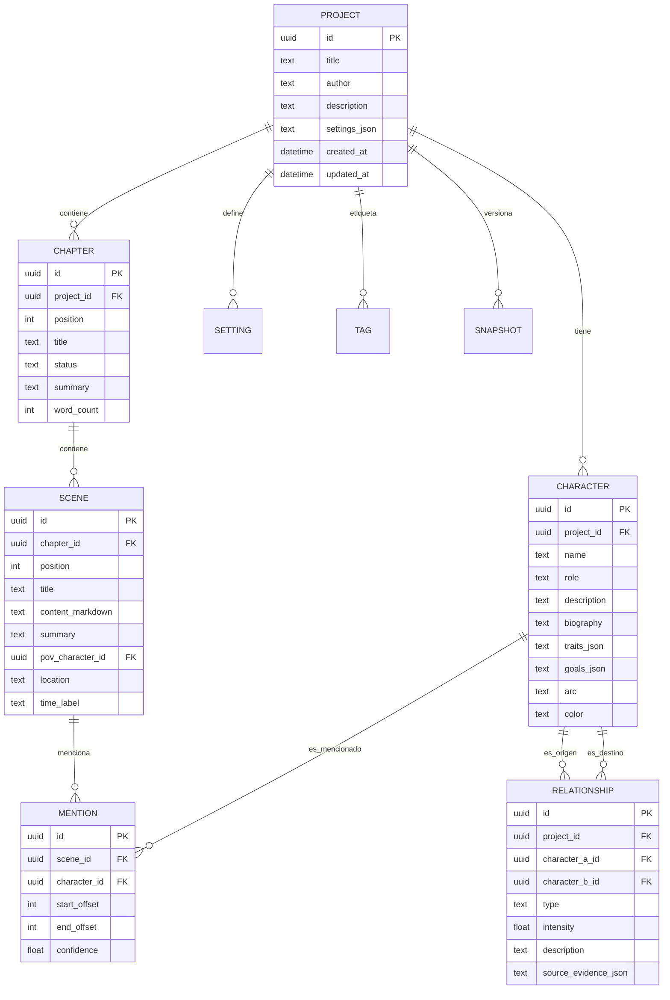

# 05 — Modelo de datos

Modelo relacional para **Pluma**, implementado en SQLite. Se mantiene el Markdown como
fuente de verdad del contenido; el resto son metadatos estructurados.

---

## 1. Diagrama entidad-relación



---

## 2. Esquema SQL (DDL)

```sql
CREATE TABLE project (
  id            TEXT PRIMARY KEY,
  title         TEXT NOT NULL,
  author        TEXT,
  description   TEXT,
  settings_json TEXT,
  created_at    TEXT NOT NULL DEFAULT (datetime('now')),
  updated_at    TEXT NOT NULL DEFAULT (datetime('now'))
);

CREATE TABLE chapter (
  id          TEXT PRIMARY KEY,
  project_id  TEXT NOT NULL REFERENCES project(id) ON DELETE CASCADE,
  position    INTEGER NOT NULL,
  title       TEXT NOT NULL,
  status      TEXT NOT NULL DEFAULT 'draft',      -- draft | revised | final
  summary     TEXT,
  word_count  INTEGER NOT NULL DEFAULT 0
);

CREATE TABLE scene (
  id                 TEXT PRIMARY KEY,
  chapter_id         TEXT NOT NULL REFERENCES chapter(id) ON DELETE CASCADE,
  position           INTEGER NOT NULL,
  title              TEXT,
  content_markdown   TEXT NOT NULL DEFAULT '',
  summary            TEXT,
  pov_character_id   TEXT REFERENCES character(id) ON DELETE SET NULL,
  location           TEXT,
  time_label         TEXT
);

CREATE TABLE character (
  id           TEXT PRIMARY KEY,
  project_id   TEXT NOT NULL REFERENCES project(id) ON DELETE CASCADE,
  name         TEXT NOT NULL,
  role         TEXT,
  description  TEXT,
  biography    TEXT,
  traits_json  TEXT,
  goals_json   TEXT,
  arc          TEXT,
  color        TEXT
);

CREATE TABLE relationship (
  id                  TEXT PRIMARY KEY,
  project_id          TEXT NOT NULL REFERENCES project(id) ON DELETE CASCADE,
  character_a_id      TEXT NOT NULL REFERENCES character(id) ON DELETE CASCADE,
  character_b_id      TEXT NOT NULL REFERENCES character(id) ON DELETE CASCADE,
  type                TEXT,
  intensity           REAL,
  description         TEXT,
  source_evidence_json TEXT
);

CREATE TABLE mention (
  id            TEXT PRIMARY KEY,
  scene_id      TEXT NOT NULL REFERENCES scene(id) ON DELETE CASCADE,
  character_id  TEXT NOT NULL REFERENCES character(id) ON DELETE CASCADE,
  start_offset  INTEGER NOT NULL,
  end_offset    INTEGER NOT NULL,
  confidence    REAL NOT NULL DEFAULT 1.0
);

CREATE TABLE snapshot (
  id           TEXT PRIMARY KEY,
  project_id   TEXT NOT NULL REFERENCES project(id) ON DELETE CASCADE,
  created_at   TEXT NOT NULL DEFAULT (datetime('now')),
  payload_json TEXT NOT NULL
);

CREATE TABLE setting (
  id          TEXT PRIMARY KEY,
  project_id  TEXT NOT NULL REFERENCES project(id) ON DELETE CASCADE,
  name        TEXT NOT NULL,
  description TEXT
);

CREATE TABLE tag (
  id          TEXT PRIMARY KEY,
  project_id  TEXT NOT NULL REFERENCES project(id) ON DELETE CASCADE,
  name        TEXT NOT NULL
);

CREATE INDEX idx_chapter_project   ON chapter(project_id, position);
CREATE INDEX idx_scene_chapter     ON scene(chapter_id, position);
CREATE INDEX idx_character_proj    ON character(project_id);
CREATE INDEX idx_mention_scene     ON mention(scene_id);
CREATE INDEX idx_relationship_proj ON relationship(project_id);
```

---

## 3. Decisiones clave

1. **`content_markdown` es la fuente de verdad** del texto de la escena. Las tablas
   `chapter`/`scene` son una proyección optimizada para navegación y búsqueda.
2. **`mention`** guarda las apariciones detectadas de un personaje (con *offset*) para
   navegar a la referencia exacta y calcular líneas de tiempo.
3. **`relationship`** guarda `source_evidence_json` para trazar *por qué* se sugirió una
   relación (transparencia y edición manual).
4. **`snapshot`** habilita el historial local de versiones sin depender de Git.
5. Los campos `*_json` evitan tablas auxiliares para listas cortas (rasgos, objetivos).

---

## 4. Mapeo de IDs en Rust

Se recomienda `uuid` v4 como PK, expuesto al frontend como `String`. En Rust, el tipo
dominio `ProjectId(uuid::Uuid)` evita mezclar IDs de entidades distintas.

> **Nota de implementación (Fase 0):** el esquema actual en
> `src-tauri/migrations/0001_init.sql` implementa `project`, `chapter` y `scene`
> (incluyendo `word_count` y marcas de tiempo ISO-8601). Las tablas de personajes,
> relaciones, menciones, snapshots, settings y tags se añadirán en la Fase 2 como
> migración `0002`.
