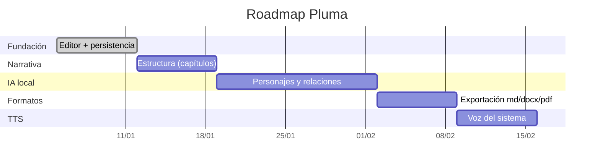

# 06 — Roadmap

Plan de fases con hitos y **criterios de salida** verificables. Se prioriza un MVP
funcional que demuestre el ciclo completo (escribir → analizar → exportar) antes de
añadir IA profunda o TTS neuronal.

---

## Fase 0 — Fundación ✅ (implementada)

**Objetivo**: proyecto corriendo con editor y persistencia.

- [x] Scaffold Svelte 5 + TypeScript + Tauri v2.
- [x] Editor TipTap (WYSIWYG) + toggle a CodeMirror (Markdown fuente).
- [x] CRUD de proyectos/capítulos/escenas (SQLite + migraciones versionadas).
- [x] Autoguardado con debounce e indicador de estado.

**Criterio de salida**: escribir en el editor, cerrar y reabrir la app conserva el texto.

---

## Fase 1 — Estructura narrativa ✅ (implementada)

**Objetivo**: el manuscrito se organiza solo.

- [x] Parser Markdown → árbol de capítulos/escenas/beats (`parser/`) + tests unitarios.
- [x] Importar un manuscrito (`.md` / `.txt`) completo (selector de archivo nativo).
- [x] Importar `.pdf` con capa de texto.
- [x] Reordenamiento por arrastrar y soltar.
- [x] Metadatos por escena (estado, resumen, POV, lugar, tiempo).
- [x] OCR de imágenes y PDFs escaneados (opcional: requiere Tesseract + Poppler).

**Criterio de salida**: pegar un Markdown con encabezados y ver el árbol generado. ✅

---

## Fase 2 — Personajes y relaciones ✅ (Capa 1 + Capa 2 básica)

**Objetivo**: detección asistida por IA local.

- [x] Migraciones `0002`/`0003` (metadatos + personajes/relaciones).
- [x] NER por reglas + atribución de diálogo (Capa 1).
- [x] Resolución de alias por similitud de cadenas (`strsim`).
- [x] Fichas de personaje (rol + descripción + eliminación).
- [x] Co-ocurrencia → relaciones con tipo (familia/romance/rivalidad/amistad).
- [x] Enriquecimiento de descripciones con LLM local (Ollama, opcional).

**Capa 2 avanzada** (embeddings + NER GLiNER2): implementada en la Fase 5, opt-in.

**Criterio de salida**: en un texto de prueba, se detectan los personajes principales y
se genera una ficha con relaciones sugeridas. ✅

---

## Fase 3 — Exportación ✅ (implementada)

**Objetivo**: compatibilidad con Word/Notion/Obsidian.

- [x] Exportar Markdown y TXT.
- [x] Exportar Word (`.docx`) y HTML.
- [x] Exportar PDF.
- [x] Importar DOCX.

**Criterio de salida**: exportar un capítulo a `.docx` y abrirlo en Word. ✅

---

## Fase 4 — TTS básico ✅ (implementado)

- [x] TTS con voz del sistema (macOS/Windows/Linux).
- [x] Controles reproducir/detener.
- [ ] Selección de voz/velocidad y resaltado por oración (pendiente).

**Criterio de salida**: escuchar un capítulo con la voz del sistema. ✅

---

## Fase 5 — IA profunda (en curso)

- [x] Integración **Ollama** (opcional) para enriquecer descripciones de personaje.
- [x] Embeddings (`fastembed`) para resolución de alias semántica (opt-in).
- [x] NER con **GLiNER2** (`gliner2-rs`) como motor opcional, con fallback a reglas.
- [x] Bootstrap autocontenido del **runtime de ONNX Runtime** (descarga opt-in).
- [x] **Entidades** no humanas (lugares y facciones) con GLiNER2.
- [x] **Hoja de personaje** (ficha detallada) y pestañas de análisis.
- [x] **Corrector gramatical** con LLM local (Ollama).
- [x] **Perfil de rendimiento**: mantener modelos en memoria (opt-in, `keep_loaded`).
- [x] **Exportar/importar EPUB** y **inferencia de estructura** para texto plano.
- [x] **Versionado (snapshots)** con detección de cambios por huella SHA-256.
- [x] **Rendimiento**: análisis incremental y importación con sentencias preparadas.
- [x] **Navegación**: conmutador rápido (`Ctrl/Cmd+K`) y atajos entre capítulos/escenas.
- [x] **Vista de árbol** (índice multinivel) además de la vista separada; paneles persistidos entre sesiones.
- [x] **Progreso de escritura** por capítulo (objetivo de palabras) y búsqueda de proyectos.
- [ ] TTS neuronal local (Piper) y voces por personaje.
- [ ] Test de ida y vuelta EPUB (exportar → importar y verificar capítulos).
- [ ] Ampliar el clasificador de estructura: encabezados centrados y numeración `1.` / `1)`.

**Criterio de salida**: con Ollama activo, generar una ficha enriquecida desde un
fragmento; sin Ollama, la app sigue funcionando con la Capa 1.

---

## Resumen de prioridades por fase

> Las fechas son ilustrativas; el orden es lo importante.
