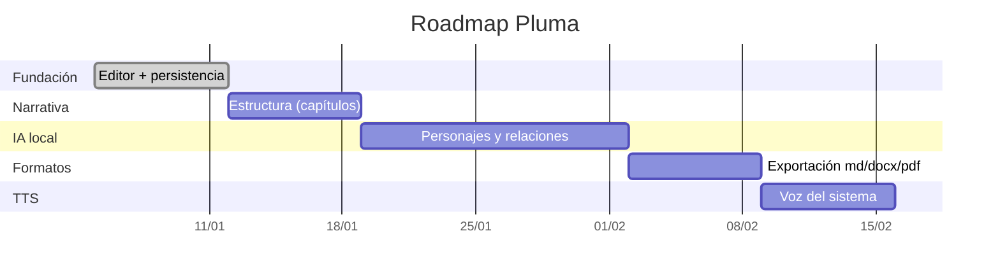

# 06 — Roadmap

Plan de fases con hitos y **criterios de salida** verificables. Se prioriza un MVP
funcional que demuestre el ciclo completo (escribir → analizar → exportar) antes de
añadir IA profunda o TTS neuronal.

---

## Fase 0 — Fundación ✅ (implementada)

**Objetivo**: proyecto corriendo con editor y persistencia.

- [x] Scaffold Svelte 5 + TypeScript + Tauri v2.
- [x] Editor TipTap (WYSIWYG) + toggle a CodeMirror (Markdown fuente).
- [x] CRUD de proyectos/capítulos/escenas (SQLite + migraciones versionadas).
- [x] Autoguardado con debounce e indicador de estado.

**Criterio de salida**: escribir en el editor, cerrar y reabrir la app conserva el texto.

---

## Fase 1 — Estructura narrativa

**Objetivo**: el manuscrito se organiza solo.

- [ ] Parser Markdown → árbol de capítulos/escenas/beats (`parser/`).
- [ ] Importar un manuscrito `.md` completo.
- [ ] Reordenamiento por arrastrar y soltar.
- [ ] Metadatos por escena (estado, resumen, POV).

**Criterio de salida**: pegar un Markdown con encabezados y ver el árbol generado.

---

## Fase 2 — Personajes y relaciones

**Objetivo**: detección asistida por IA local.

- [ ] Migración `0002` (personajes, relaciones, menciones).
- [ ] NER por reglas + atribución de diálogo (Capa 1).
- [ ] Embeddings (`fastembed-rs`) para resolución de alias.
- [ ] Fichas de personaje editables.
- [ ] Co-ocurrencia → relaciones sugeridas + grafo visual.

**Criterio de salida**: en un texto de prueba, se detectan los personajes principales y
se genera una ficha con relaciones sugeridas (editables).

---

## Fase 3 — Exportación

**Objetivo**: compatibilidad con Word/Notion/Obsidian.

- [ ] Exportar Markdown y TXT.
- [ ] Exportar Word (`.docx`) y HTML.
- [ ] Exportar PDF.
- [ ] Importar Markdown/TXT/DOCX.

**Criterio de salida**: exportar un capítulo a `.docx` y abrirlo en Word sin perder
negritas, encabezados ni listas.

---

## Fase 4 — TTS básico

- [ ] TTS con voz del sistema (macOS/Windows/Linux).
- [ ] Controles reproducir/pausar/detener, velocidad y voz.
- [ ] Resaltado por oración.

**Criterio de salida**: escuchar un capítulo con la voz del sistema.

---

## Fase 5 — IA profunda (futuro)

- [ ] NER con `ort` (modelo cuantizado) para mayor precisión.
- [ ] Integración **Ollama** (opcional) para fichas y relaciones enriquecidas.
- [ ] Exportar EPUB.
- [ ] TTS neuronal local (Piper) y voces por personaje.

**Criterio de salida**: con Ollama activo, generar una ficha enriquecida desde un
fragmento; sin Ollama, la app sigue funcionando con la Capa 1.

---

## Resumen de prioridades por fase

> Las fechas son ilustrativas; el orden es lo importante.
