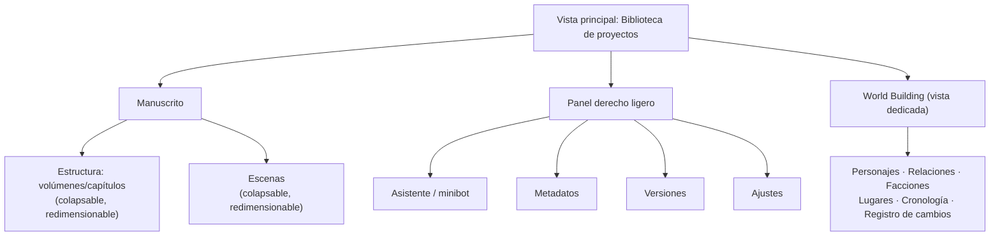
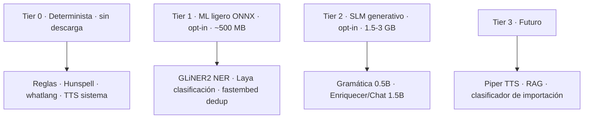

# 08 — Plan maestro de producto

> Este documento es la **referencia superior** de Pluma. Toma las decisiones sueltas de
> los docs `01`–`07` y las convierte en una sola visión coherente: **qué es**, **para
> quién**, **cómo se organiza** y **hacia dónde va**. Cuando haya dudas de prioridad o de
> diseño, este plan manda.

---

## 1. Visión

**Pluma** es un editor de escritorio para **novelistas serios que escriben obras largas**
(novelas y sagas de cientos de miles de palabras) y quieren **organizarlo todo en un solo
lugar**, sin depender de **IA en la nube** ni de **hardware potente**.

Sustituye, en una sola aplicación local, a la combinación de **Word + Scrivener + Obsidian +
Notion + un cuaderno de "biblia de la novela"**, con IA local **opcional, ligera y modular**.

### Persona objetivo

| Rasgo | Descripción |
|-------|-------------|
| **Quién** | «Elena»: escribe una saga de fantasía de 4 volúmenes, ~500 000 palabras. |
| **Qué tiene** | 40+ personajes, mapa, cronología, facciones, sistemas de magia. |
| **Hardware** | Portátil de gama media, CPU sin GPU dedicada, 8 GB de RAM. |
| **Dolor real** | Mantener coherencia a lo largo de años de escritura sin perderse entre archivos, apps y notas. |
| **Necesidad** | Escribir sin fricción, ver el estado del manuscrito, y exportar a estándares de publicación. |

### Promesa central

> Escribe. La app entiende la estructura (volúmenes/capítulos/escenas), detecta personajes,
> lugares y relaciones, mantiene la biblia actualizada, y te deja exportar a `.docx`, `.epub`,
> `.pdf` y Markdown. **Todo local, todo tuyo, y todo funciona sin IA**; la IA solo refina
> cuando tú la activas.

---

## 2. Restricciones de diseño (no negociables)

| # | Restricción | Consecuencia |
|---|-------------|--------------|
| 1 | **Offline-first** | El 100 % del flujo de escritura funciona sin internet. |
| 2 | **Cero dependencia de IA externa** | El análisis funciona con reglas; toda IA es local, opt-in y con fallback. |
| 3 | **Bajo consumo** | El núcleo corre en CPU y máquinas de 4–8 GB; la IA no se carga a menos que se active. |
| 4 | **Privacidad** | El manuscrito y su análisis **nunca salen del equipo**. |
| 5 | **Nada obligatorio, todo opcional** | Modelos, TTS neural, OCR y formatos extra se descargan bajo demanda con permiso. |
| 6 | **Extensibilidad** | Nuevos motores/formatos/voces se añaden sin reescribir el núcleo. |
| 7 | **Rendimiento como feature** | Una novela larga no puede hacer esperar al escritor ni trabar el editor. |
| 8 | **Idiomático** | Rust idiomático (traits, `thiserror`, `params!`) y Svelte 5 estricto, tipado, 0 warnings. |

---

## 3. Principios de diseño (los "porqués")

1. **El manuscrito es la fuente de verdad.** Estructura, personajes, cronología y relaciones
   se **derivan** del texto. Pluma nunca impone un formato propietario: el Markdown es el
   formato de intercambio canónico.
2. **Organización incremental, no burocrática.** La app detecta estructura y entidades sola;
   el usuario solo **confirma o corrige**. Nunca se exige rellenar fichas para escribir.
3. **Cada tarea al mínimo coste capaz (cascade).** Reglas → ML ligero (ONNX) → SLM generativo.
   Un LLM nunca hace lo que una regla resuelve.
4. **IA como refuerzo, no como requisito.** El producto es 100 % útil sin IA; la IA sube la
   calidad de análisis, no habilita la app.
5. **Rendimiento primero en el camino largo.** El diseño asume una novela de 500k+ palabras
   desde el día uno (ver §6).

---

## 4. El escritorio del novelista (modelo de UI/UX)

La interfaz se organiza en **tres zonas**, pensada para no perderse en obras largas:

- **Biblioteca**: vista principal de selección de proyectos (buscar, crear, importar desde archivo).
- **Estructura/escenas**: dos paneles colapsables y redimensionables, con **modo árbol
  multinivel XOR modo separado** (nunca ambos). Niveles renombrables («Volúmenes»/«Capítulos»,
  etc.) y ocultación automática del 2º nivel si no hay escenas.
- **Navegación sin fricción**: conmutador rápido (`Ctrl/Cmd+K`), atajos entre capítulos/escenas,
  resaltado del elemento activo.
- **Panel derecho ligero**: solo lo que se usa a diario. El análisis pesado vive en
  **World Building** como vista dedicada, no como panel permanente.

> Este modelo ya está implementado en gran parte (vista de proyectos, paneles colapsables,
> árbol XOR separado, World Building, panel derecho ligero). El plan lo consolida como la
> **forma canónica de navegar una novela larga**.

---

## 5. Funcionalidades por área

### 5.1 Escritura y edición

| Estado | Funcionalidad |
|--------|---------------|
| ✅ | Editor híbrido WYSIWYG (TipTap) + Markdown fuente (CodeMirror), ida y vuelta sin pérdida. |
| ✅ | Autoguardado con debounce + guardado manual (`Ctrl/Cmd+S`) + crash recovery. |
| ✅ | Ortografía Hunspell multilingüe con detección de idioma (`whatlang`) y diccionarios bajo demanda. |
| 🔜 | Modo foco / máquina de escribir (distraction-free). |
| 🔜 | Split-view (editor + vista previa renderizada). |
| 🔜 | Atajos configurables y paleta de comandos. |
| 🔜 | Comentarios/notas al margen por escena (para revisiones). |

### 5.2 Estructura narrativa

| Estado | Funcionalidad |
|--------|---------------|
| ✅ | Parser Markdown → volúmenes/capítulos/escenas/beats, con patrones configurables. |
| ✅ | Niveles renombrables y ocultación automática del 2º nivel. |
| ✅ | Reordenamiento drag & drop (incluido reordenar escenas dentro de capítulo en modo árbol). |
| ✅ | Metadatos por capítulo/escena (estado, resumen, POV, lugar, tiempo, etiquetas). |
| 🔜 | Clasificador de estructura mejorado (encabezados centrados, numeración `1.` / `1)`, etc.). |
| 🔜 | Reordenar reorganiza el Markdown de forma consistente al exportar. |

### 5.3 World Building (la "biblia" de la novela)

El corazón del valor para un novelista serio. Todo vive en la vista dedicada:

| Área | Descripción | Estado |
|------|-------------|--------|
| **Personajes** | Ficha técnica editable: nombre, alias, rol, descripción, apariencia, voz, motivación, arco, notas, color. | ✅ (base) |
| **Relaciones** | Grafo personaje↔personaje con tipo, polaridad, intensidad y evidencia (cita). | ✅ (base) |
| **Facciones** | Grupos/organizaciones con descripción y miembros. | ✅ |
| **Lugares** | Geografía de la historia. | ✅ |
| **Cronología** | Línea de tiempo in-story (eventos con fecha/orden) para detectar agujeros de trama. | 🔜 |
| **Objetos/artefactos** | Elementos relevantes (sistemas de magia, tecnología). | 🔜 |
| **Registro de cambios** | Bitácora de qué detectó/cambió el análisis y cuándo. | ✅ (en memoria) → 🔜 persistido |
| **Notas de investigación** | Notas sueltas ligadas al proyecto, fuera del manuscrito. | 🔜 |

**Principio**: la biblia se **alimenta sola** del análisis y se **edita a mano** para corregir.
El usuario no rellena fichas desde cero; confirma lo detectado.

### 5.4 Análisis asistido (IA local)

Ver §7. Resumen del alcance:

- **NER** de personajes/entidades (reglas + GLiNER2 opt-in).
- **Alias** (similitud de cadenas + embeddings opt-in).
- **Relaciones** (reglas + Laya opt-in para el tipo + escalada a SLM solo si hay ambigüedad).
- **Enriquecimiento** de descripciones (SLM opt-in).
- **Gramática** (modelo ligero dedicado) + **ortografía** (Hunspell, sin LLM).

### 5.5 Importación y exportación

| Formato | Importar | Exportar | Notas |
|---------|:--------:|:--------:|-------|
| Markdown (`.md`) | ✅ | ✅ | Formato canónico. |
| Texto plano (`.txt`) | ✅ | ✅ | Con inferencia de estructura (capítulos/escenas). |
| Word (`.docx`) | ✅ | ✅ | Todas las versiones soportadas por el extractor. |
| PDF | ✅ (texto) | ✅ | OCR de escaneados opcional (Tesseract+Poppler). |
| EPUB | ✅ | ✅ | Test de ida y vuelta pendiente. |
| HTML | — | ✅ | |

- **Importar un archivo completo crea un proyecto** cuyo título es el nombre del archivo.
- **Portada**: se copia al directorio de datos al crear/importar; **su uso en la exportación
  queda pendiente** (PDF/EPUB).
- 🔜 Inferencia de división para texto plano sin estructura (clasificador ligero).

### 5.6 Texto a voz (TTS)

| Estado | Funcionalidad |
|--------|---------------|
| ✅ | Voz del sistema (reproducir/pausar/detener). |
| 🔜 | Selección de voz y velocidad + resaltado por oración. |
| 🔜 | TTS neuronal local (Piper), voces por personaje (sin nube). |

### 5.7 Versionado y respaldo

| Estado | Funcionalidad |
|--------|---------------|
| ✅ | Snapshots con detección de cambios por huella SHA-256 (guardar/restaurar/eliminar). |
| 🔜 | **Respaldo tipo git-ligero**: versionar solo las *partes* que cambian (por capítulo/escena), no todo el proyecto. |
| 🔜 | Exportación de respaldo completa (zip del proyecto + biblia + notas). |

### 5.8 Búsqueda y navegación

| Estado | Funcionalidad |
|--------|---------------|
| ✅ | Conmutador rápido (`Ctrl/Cmd+K`), atajos, árbol multinivel. |
| ✅ | Búsqueda de proyectos. |
| 🔜 | **Búsqueda global FTS5** sobre manuscrito + biblia (instántanea en 500k palabras). |
| 🔜 | Saltar a "próxima escena sin revisar" / filtros por estado. |

### 5.9 Progreso y objetivos

| Estado | Funcionalidad |
|--------|---------------|
| ✅ | Objetivo de palabras configurable por proyecto + progreso por capítulo. |
| 🔜 | Objetivo diario y racha de escritura. |
| 🔜 | Estadísticas globales (palabras totales, ritmo por capítulo, POVs usados). |

---

## 6. Estrategia de rendimiento para novelas largas

El diseño asume **una novela de 500k+ palabras** como caso de uso normal, no de borde.

| Problema | Estrategia |
|----------|------------|
| Editor lento en documentos enormes | Carga por capítulo/escena; no se renderiza el manuscrito completo de una vez. |
| Búsqueda lenta | Índice **FTS5** de SQLite (búsqueda de texto completa nativa). |
| Análisis que rehace trabajo | **Incremental**: huella SHA-256 por unidad; solo se reanaliza lo que cambió. |
| Análisis que traba la UI | **En segundo plano** (async), con barra de progreso, acotado al capítulo en curso y solo en estado Revisado/Final. |
| Memoria alta por modelos | Modelos **opt-in** y **no residentes** salvo perfil `keep_loaded`; cascade por capas de coste. |
| Importación de manuscritos grandes | Sentencias preparadas y escritura por lotes. |
| Muchos capítulos → navegación tediosa | Árbol multinivel, conmutador rápido, paneles colapsables/redimensionables. |
| Autoguardado frecuente | Debounce + guardado diferencial (solo lo modificado). |

**Regla**: ninguna operación bloquea el hilo de UI; todo lo pesado es async en Rust.

---

## 7. Arquitectura de IA local (modular por capas de coste)

La IA se estructura en **tiers**. Cada tarea corre en el tier más barato que la haga bien y
escala al siguiente **solo si la confianza es baja**:

| Tarea | Tier 0 | Tier 1 | Tier 2 | Fallback |
|-------|:------:|:------:|:------:|----------|
| NER de entidades | ✅ reglas | ✅ GLiNER2 | — | reglas |
| Dedup de alias | ✅ `strsim` | ✅ embeddings | — | reglas |
| Tipo de relación | ✅ reglas | ✅ **Laya** | SLM (ambiguo) | reglas |
| Enriquecer descripción | — | — | ✅ SLM | (sin IA) |
| Gramática | — | — | ✅ 0.5B | (sin IA) |
| Ortografía | ✅ Hunspell | — | — | — |
| Chat/asistente | — | — | ✅ SLM | (sin IA) |
| TTS | ✅ sistema | — | 🔜 Piper | sistema |

### Decisiones clave

- **Laya** (decision-model ONNX, ~421M, base ModernBERT, multilingüe, Apache 2.0) se integra
  en **Tier 1** para clasificar el **tipo de relación** (familia/romance/rivalidad/amistad),
  desplazando esa tarea fuera del SLM. Reutiliza el runtime `ort` ya usado por GLiNER2.
  **Alcance inicial: solo tipo de relación** (no dedup, que ya cubre embeddings).
- **Ortografía/gramática** se separa del LLM: Hunspell para ortografía y un modelo **0.5B
  dedicado** para gramática, no un LLM de propósito general.
- **Todo es opt-in y modular**: nada se descarga sin permiso; existe perfil `keep_loaded` para
  quien tiene recursos y lo quiere residente.
- **Pendiente de verificar antes de codificar Laya**: checkpoint ONNX exacto y formato
  entrada/salida (hay candidatos en HF sin confirmar).

---

## 8. Roadmap completo

> El detalle histórico (fases 0–5) vive en `docs/06-roadmap.md`. Aquí se presenta el
> **camino completo hacia el producto para novelistas serios**, con lo nuevo en negrita.

### Fase 0–4 · Fundación ✅ (implementado)
Editor, estructura, personajes/relaciones base, exportación, TTS básico. *(ver `06-roadmap.md`)*

### Fase 5 · IA profunda 🟡 (en curso)
GLiNER2, embeddings, runtime ONNX autocontenido, entidades, hoja de personaje, corrector,
perfil `keep_loaded`, EPUB, versionado, rendimiento incremental, árbol, progreso, análisis en
segundo plano, niveles configurables, World Building, ortografía multilingüe.

### Fase 6 · La biblia completa 🔜
**Objetivo**: un novelista serio mantiene toda la coherencia de su saga.

- [ ] **Cronología** in-story (eventos con orden/fecha) y detección de inconsistencias.
- [ ] **Registro de cambios persistido** del análisis (no solo en memoria).
- [ ] **Ficha de personaje ampliada** (apariencia, voz, motivación, arco, notas).
- [ ] **Objetos/artefactos** y **notas de investigación** ligadas al proyecto.
- [ ] **Laya** (Tier 1) para tipado de relación, con fallback a reglas y escalada a SLM.
- [ ] Búsqueda global **FTS5** sobre manuscrito + biblia.
- [ ] Respaldo git-ligero (versionar solo lo que cambia).

**Criterio de salida**: cargar una saga de 300k palabras, ver personajes/relaciones/cronología
coherentes, buscar cualquier término al instante y restaurar una versión antigua de un capítulo.

### Fase 7 · Importación y exportación sin fricción 🔜
- [ ] **Portada en la exportación** (PDF/EPUB) usando `project.cover_path`.
- [ ] Test de ida y vuelta EPUB (exportar → importar → verificar capítulos).
- [ ] Clasificador ligero de **división de estructura** para texto plano sin formato.
- [ ] Exportación selectiva (capítulo/selección), plantillas de exportación.

### Fase 8 · Escritura profesional 🔜
- [ ] TTS neuronal local (Piper) + voces por personaje.
- [ ] Modo foco, split-view, atajos configurables.
- [ ] Objetivo diario, racha y estadísticas de escritura.
- [ ] Comentarios/notas al margen para revisiones.

### Fase 9 · Pulido multiplataforma 🔜
- [ ] Empaquetado e instaladores para macOS/Windows/Linux.
- [ ] Rendimiento: benchmarks en manuscritos de 500k palabras.
- [ ] Accesibilidad (navegación por teclado, contraste).

---

## 9. Criterios de éxito (aceptación de producto)

1. Un autor abre Pluma sin internet, crea una novela, escribe, y la estructura se genera sola.
2. Con 500k palabras y 40+ personajes: apertura < 2 s, editor < 50 ms de respuesta, búsqueda
   instantánea, análisis en segundo plano sin trabar la UI.
3. Sin instalar nada, el análisis funciona por reglas (personajes, alias, relaciones).
4. Activando IA local (con permiso), la calidad del análisis sube (NER fino, dedup semántico,
   tipado de relación) **sin enviar nada a la nube**.
5. Se importa un manuscrito `.docx`/`.epub`/`.pdf`/`.txt` y se exporta a `.docx`/`.epub`/
   `.pdf`/Markdown sin pérdida.
6. El TTS lee el capítulo para proof-listening (sistema hoy, neuronal en el futuro).
7. Se puede restaurar cualquier versión anterior de un capítulo (respaldo ligero).

---

## 10. No-goles (v1)

Explícito para no desviar el foco:

- ❌ Colaboración en tiempo real / multiusuario (local-first, un solo autor).
- ❌ Sincronización en la nube (contradice privacidad/offline-first).
- ❌ Modelos de IA grandes (≥3B) como base; solo opt-in y escalada puntual.
- ❌ Motor de reglas complejo de "mapa mental" tipo Scapple; la cronología y el grafo bastan.
- ❌ Formato propietario; Markdown es el formato de intercambio.

---

## 11. Mapa de documentos

| Documento | Rol |
|-----------|-----|
| `08-plan-maestro.md` | **Este plan**: visión, principios, roadmap de producto. |
| `01-requisitos.md` | Requisitos FR/NFR y aceptación. |
| `02-arquitectura.md` | Capas y flujo de datos técnico. |
| `03-ia-local.md` | Motores y decisión de modelos. |
| `04-tts.md` | TTS básico y neural. |
| `05-modelo-de-datos.md` | Esquema SQLite y entidades. |
| `06-roadmap.md` | Fases históricas con criterios de salida. |
| `07-investigacion-ia.md` | Investigación de modelos/algoritmos. |

---

## 12. Deuda técnica (a futuro)

Registro de optimizaciones/mejoras conocidas que se postergan deliberadamente (no
bloquean el MVP).

| # | Área | Deuda | Nota |
|---|------|-------|------|
| 1 | RAG | Embeddings guardados como **JSON** (~3 KB/escena) | Migrar a **BLOB binario** (`f32` little-endian) para proyectos grandes |
| 2 | RAG | Recuperación **sin umbral de relevancia mínima** (coseno a secas) | Filtrar escenas con similitud < umbral para reducir ruido en el contexto |
| 3 | Búsqueda | Búsqueda del mundo con **LIKE** | Migrar a **FTS5** para ranking y búsqueda difusa cuando el world building crezca |
| 4 | Rendimiento | `chat` RAG sin `keep_loaded` recarga el embedder por mensaje | Aceptable; con `keep_loaded` se evita. Evaluar cacheado más agresivo |

> Resueltos (2026): **API key cifrada en el llavero del SO** y **perfiles por capacidad
> de equipo** (ver `docs/03` §9 y §10).
